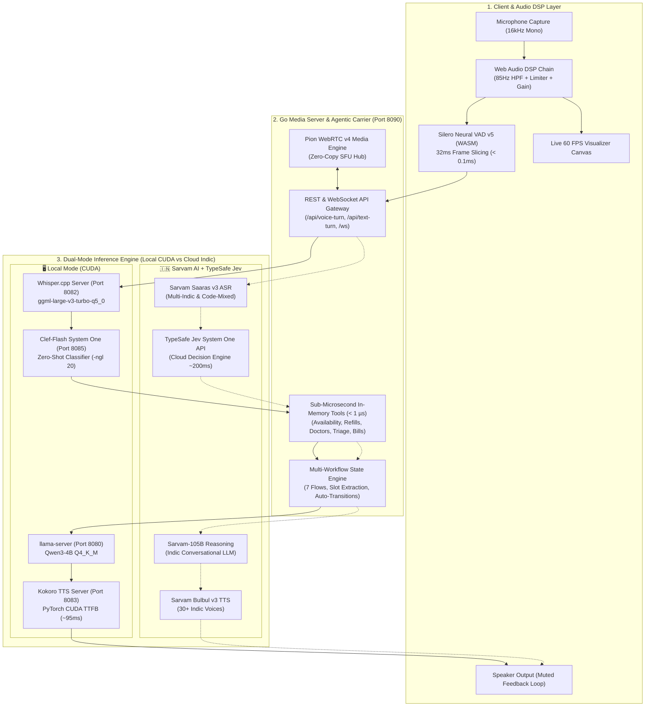
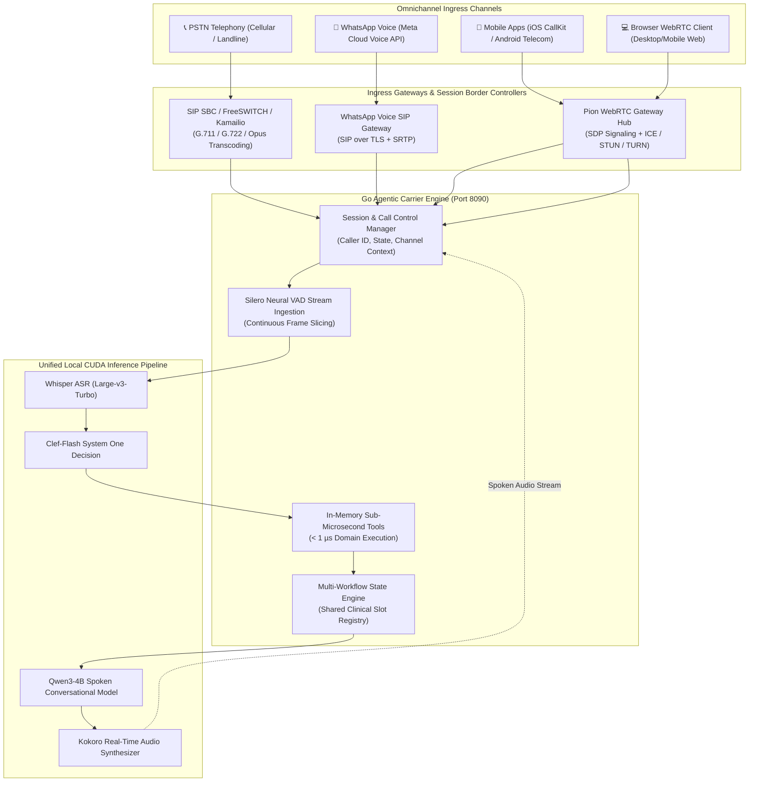

# Beacon Health | Omnichannel Real-Time Voice Agent Architecture

This document details the verified **Production Architecture** of the Beacon Health Real-Time Agentic Voice Carrier and specifies the **Omnichannel Scaling Blueprint** across **PSTN Telephony (SIP)**, **WhatsApp Voice Calling**, and **Native Mobile Applications (iOS / Android)**.

---

## 1. Verified Core Architecture (Local RTX 3060 CUDA Stack)

### Component Breakdown
1. **Frontend Audio DSP Chain & Silero Neural VAD v5 (`web/index.html`)**:
   - **Google Meet 85Hz High-Pass Filter**: Cuts room noise and desk fan motor rumble ($20\text{--}80\,\text{Hz}$).
   - **Broadcast Dynamics Compressor & Limiter**: Normalizes sitting distance ($30\text{--}60\,\text{cm}$) to $-18\,\text{dBFS}$.
   - **In-Browser Silero V5 WASM Engine**: Evaluates $32\,\text{ms}$ frames ($512$ samples at $16\,\text{kHz}$) in $<0.1\,\text{ms}$.
   - **Acoustic Echo Isolation**: Muted zero-gain node prevents microphone feedback, and a $350\,\text{ms}$ cooldown blocks room reverberation after assistant playback.
2. **Go Carrier & Media Platform (`main.go`, `agent/voice_pipeline.go`, `agent/workflow.go`)**:
   - **Pion WebRTC v4**: Provides real-time RTP/SRTP transport and signaling.
   - **Sub-Microsecond In-Memory Tool Engine**: Executes domain tools in $0.4\text{--}0.8\,\mu\text{s}$.
   - **Multi-Workflow State Engine**: Manages 7 clinical workflows, transitions, slot extraction, and dynamic system directives.
3. **Dual Decision & Inference Stacks**:
   - **Local CUDA Stack**: `Whisper.cpp` (Port `8082`), `Clef-Flash` System One (Port `8085`), `Qwen3-4B` (Port `8080`), `Kokoro TTS` (Port `8083`).
   - **Sarvam + TypeSafe Jev Stack**: `Sarvam Saaras v3` STT ($<200\,\text{ms}$), `TypeSafe Jev System One API` ($<220\,\text{ms}$ typed judgments), `Sarvam-105B` Conversational Chat LLM, and `Sarvam Bulbul v3` TTS ($30+$ Indic voices).

---

## 2. Omnichannel Integration Architecture

The core Go Carrier and Local Inference Stack remain unified while dedicated **Channel Ingress Adapters** handle signaling, codecs, and protocol translation.

---

## 3. Channel Specifications & Protocols

### A. PSTN Telephony (SIP Trunking)
- **Carrier Providers**: Twilio SIP Trunking, Telnyx, Bandwidth.com, or local E1/PRI SIP Trunks.
- **Session Border Controller (SBC)**: FreeSWITCH or Kamailio acting as SIP registrar and media proxy.
- **Codec Negotiation**: G.711 $\mu$-law (PCMU 8kHz), G.711 A-law (PCMA 8kHz), or Opus (16kHz). SBC resamples to 16kHz mono PCM stream piped to the Go Carrier.
- **Features**: Automatic Caller ID binding to patient record, DTMF keypad support, and SIP `REFER` warm transfer to human nurse/doctor.

### B. WhatsApp Voice Calling
- **Interface**: Meta Cloud API for WhatsApp Voice Calling.
- **Security & Protocol**: SIP over TLS (Port 5061) with SRTP (AES-128/256) and Opus Fullband audio (16–48kHz).
- **Features**: Simultaneous in-call rich messaging (dispatching appointment passes or prescription barcodes directly into WhatsApp chat during call).

### C. Native Mobile Applications (iOS & Android)
- **SDKs**: WebRTC Native SDK or LiveKit Client SDK.
- **Audio Hardware Processing**:
  - **iOS**: `AVAudioEngine` with `VoiceProcessingIO` (hardware AEC & AGC).
  - **Android**: `AudioManager.MODE_IN_COMMUNICATION` with native `AcousticEchoCanceler`.
- **Background Ringing**: Apple PushKit + CallKit on iOS; FCM High-Priority Push + Android Telecom ConnectionService on Android.

---

## 4. Latency & Resource Budget

| Layer | Component | Target Latency | Tech Stack | Resource |
| :--- | :--- | :--- | :--- | :--- |
| **Ingress** | Network & Transport | $10\text{--}30\,\text{ms}$ | RTP / WebRTC / SRTP | Go Pion / FreeSWITCH |
| **VAD** | Frame Evaluation | $0.1\,\text{ms}$ | Silero VAD v5 ONNX | WASM / CPU |
| **ASR** | Speech-to-Text | $180\text{--}280\,\text{ms}$ | Whisper.cpp `large-v3-turbo` | CUDA (~1.8 GB VRAM) |
| **Decision** | Zero-Shot Classifier | $30\text{--}60\,\text{ms}$ | Clef-Flash Q4_K_M | CUDA (~2.1 GB VRAM) |
| **Tools** | In-Memory Registry | $< 1\,\mu\text{s}$ | Direct Go Maps | CPU RAM |
| **LLM** | Conversational Response | $80\text{--}150\,\text{ms}$ | Qwen3-4B Q4_K_M | CUDA (~2.5 GB VRAM) |
| **TTS** | Spoken Synthesis | $70\text{--}110\,\text{ms}$ | Kokoro TTS PyTorch | CUDA (~1.2 GB VRAM) |
| **Total** | **End-to-End Turn** | **$380\text{--}650\,\text{ms}$** | **All Local Pipeline** | **12GB RTX 3060** |
