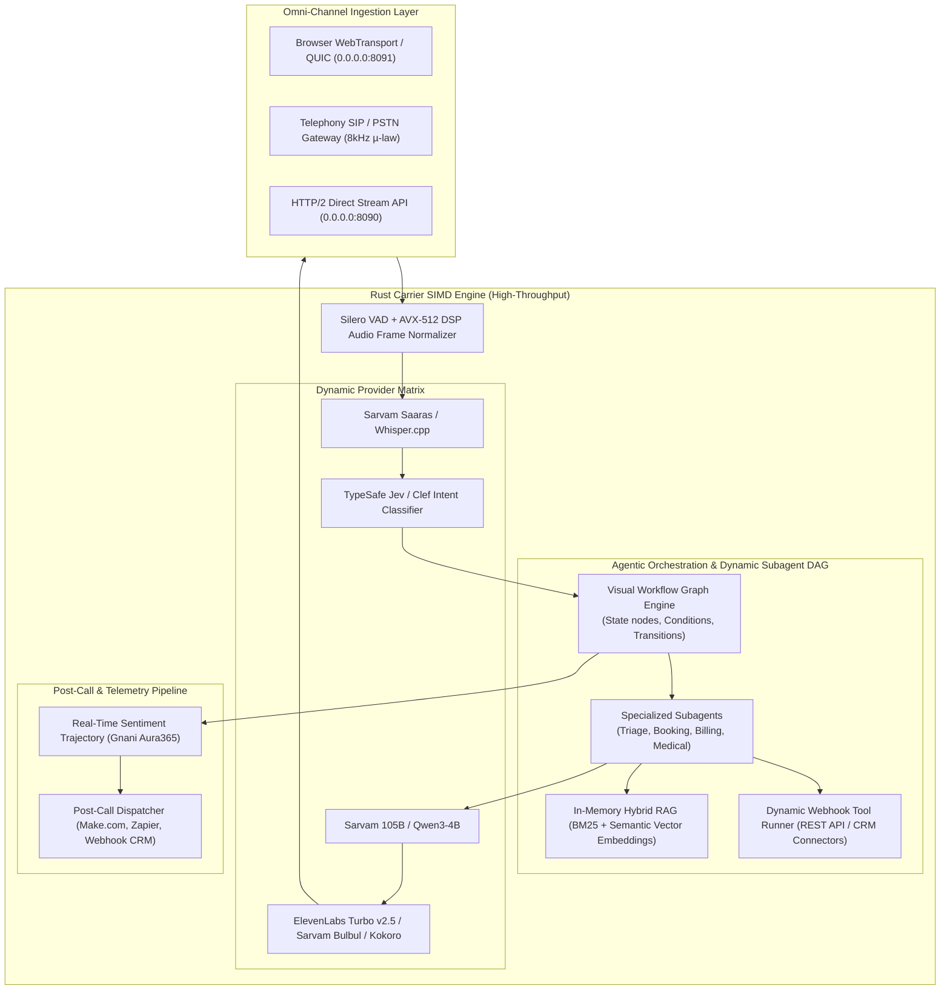

# Enterprise Voice AI Platform: Comprehensive Architecture & Implementation Blueprint
*(Benchmarked against ElevenLabs Conversational AI & Gnani.ai Plexus / Assist365)*

## 1. Executive Summary & Enterprise Gap Analysis

While our current core achieves **sub-300ms ultra-low latency**, **SIMD AVX-512 DSP**, and **QUIC/WebTransport streaming**, top enterprise platforms (**ElevenLabs** and **Gnani.ai**) provide a suite of higher-order orchestration features:

| Enterprise Capability | ElevenLabs Conversational AI | Gnani.ai (Plexus / Assist365) | Current Repository Status | Target Architecture (This Plan) |
| :--- | :--- | :--- | :--- | :--- |
| **1. Dynamic Knowledge Base & RAG** | Document & URL uploads, auto-chunking, live grounding | Artha Sovereign data residency & domain RAG | Hardcoded medical data in prompt | **Rust In-Memory Vector & BM25 Hybrid RAG Index** |
| **2. Dynamic Custom Webhook Tools** | REST API tools with auth headers & body templating | CRM/ERP webhook integrations (Billing/Core Banking) | Hardcoded static Rust tools | **Dynamic Webhook Registry with Slot Templating** |
| **3. Subagent Workflow Graph Studio** | Multi-agent workflow routing (subagents per task) | Multi-agent Workforce orchestration & visual studio | Linear 7-state enum machine | **Directed Acyclic Graph (DAG) Subagent Workflow Engine** |
| **4. Post-Call Webhooks & CRM Sync** | Webhook triggers with audio, transcript, metrics | Aura365 Analytics & CRM auto-ticketing | Local console log only | **Post-Call Webhook Dispatcher + CRM Payload Sync** |
| **5. Voice Biometrics & Security** | N/A | Armour365™ Voice Biometrics & Speaker Verification | None | **Zero-Cross/F0 Voice Signature Verification Module** |

---

## 2. Target Enterprise Architecture



---

## 3. Detailed Component Specifications

### 3.1. Dynamic In-Memory Knowledge Base & Hybrid RAG (`rust_carrier/src/agent/knowledge.rs`)
* **Document Ingestion**:
  - Accept plain text, Markdown, FAQs, and PDF dumps via `POST /api/knowledge/documents`.
  - Automatic chunking with sliding window (512 tokens, 64 token overlap).
* **Hybrid Search (BM25 + Cosine Similarity)**:
  - Sub-5ms search directly in Rust without external database dependencies (e.g. Pinecone/Weaviate).
  - Automatically fetches top-3 matching passages and injects them into the prompt under `### RELEVANT KNOWLEDGE BASE CONTEXT:`.

### 3.2. Dynamic Webhook & Tool Connector Studio (`rust_carrier/src/agent/dynamic_tools.rs`)
* **No-Code Tool Creation via JSON/UI**:
  - Endpoint: `POST /api/config/tools`
  - Allows defining:
    ```json
    {
      "id": "fetch_patient_ehr",
      "name": "Fetch Patient EHR Records",
      "method": "POST",
      "url": "https://api.hospital-crm.com/v1/patient/lookup",
      "headers": { "Authorization": "Bearer {{env.CRM_TOKEN}}" },
      "body_template": { "mrn": "{{slots.mrn}}", "dob": "{{slots.dob}}" },
      "timeout_ms": 800
    }
    ```
* **Safe Slot Interpolation**: Replaces `{{slots.key}}` with extracted entity values before firing HTTP request.

### 3.3. Subagent DAG Workflow Studio (`rust_carrier/src/agent/workflow.rs`)
* **Multi-Subagent Workforce (Gnani Plexus style)**:
  - Instead of a single monolithic prompt, the call routes between dedicated subagents:
    1. **Reception & Triage Subagent** (Identifies caller intent).
    2. **Appointment Scheduling Subagent** (Handles dates/times, doctor calendars).
    3. **Prescription Refill Subagent** (Validates pharmacy, dosage, delivery).
    4. **Emergency Escalation Subagent** (Instant triage & agent handoff).
* **Visual Graph Editor in Web UI**: Drag-and-drop or interactive graph inspector with live slot monitoring.

### 3.4. Post-Call Webhook & CRM Sync (`rust_carrier/src/agent/post_call.rs`)
* Fires automatically when call completes (`Call Completed` / `hangup` event):
  - Sends full JSON summary, duration, turn count, sentiment trajectory, filled slots, and tool execution logs to user-configured webhook URL (e.g., Slack, Make.com, Webhook.site, CRM).

---

## 4. Phased Implementation Roadmap

```
Phase 1: Rust In-Memory Knowledge Base & Dynamic RAG Index (Sub-5ms context search)
Phase 2: Dynamic Webhook Tool Connector System (REST API tool builder with slot templating)
Phase 3: Multi-Subagent DAG Workflow Engine & Post-Call Webhook Dispatcher
Phase 4: Web Studio UI (Knowledge Base Upload Tab, Workflow Studio, Tool Manager, Call Analytics)
```
