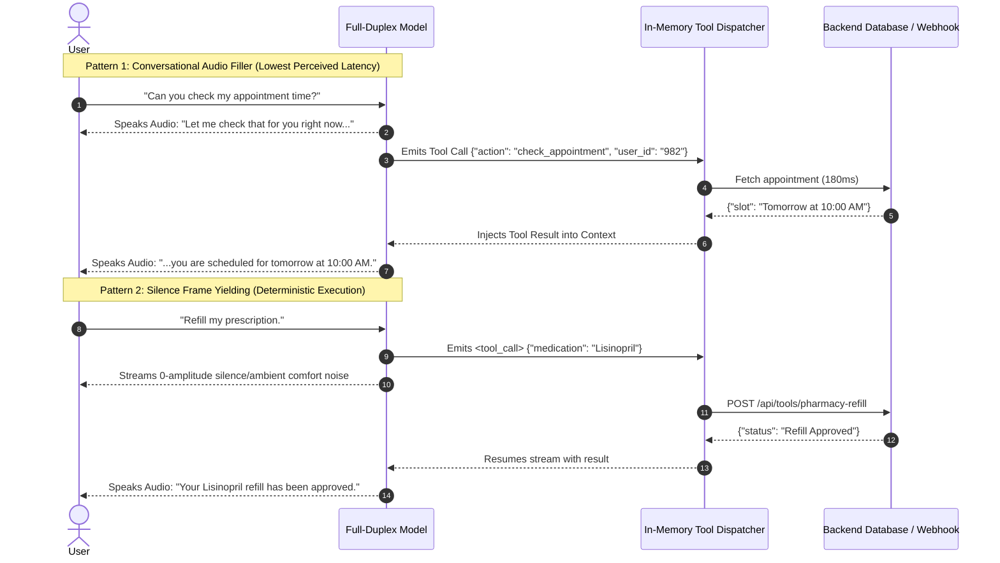

# State-of-the-Art Full-Duplex Voice-to-Voice (Speech-to-Speech) Models & Research

## 1. Overview: What is Full-Duplex Voice?

Traditional voice assistants operate in **Half-Duplex (Turn-Based)** mode:
```
[User Speaks] ➔ [VAD Silence Cutoff] ➔ [ASR Transcription] ➔ [LLM Generation] ➔ [TTS Synthesis] ➔ [Audio Output]
```
*Disadvantages*: High latency (800ms–2000ms), inability to handle overlapping speech, robotic pause before responding, and clumsy interruption handling.

**Full-Duplex (Native Speech-to-Speech)** models process continuous incoming audio frames while simultaneously streaming outgoing audio frames:
```
[User Audio Stream In] ──► ┌────────────────────────────────────────┐ ──► [Agent Audio Stream Out]
                           │  Native Dual-Stream Multimodal Core    │
[Agent Listening In]   ──► └────────────────────────────────────────┘ ──► [Conversational Overlap/Backchannel]
```
*Advantages*: Sub-200ms conversational response, natural interjections ("uh-huh", "right"), laughter while talking, and human-like barge-in / interruption without losing conversational context.

---

## 2. Comprehensive Comparison of Full-Duplex Models

| Model / Architecture | Core Backbone & Codec | Parameter Count | VRAM / Hardware Footprint | End-to-End Latency | Interruption & Backchanneling | License & Openness |
| :--- | :--- | :--- | :--- | :--- | :--- | :--- |
| **Kyutai Moshi** | **Mimi Codec (24kHz)** + Helium-7B Transformer | **7.6B Total** | **~8 GB – 12 GB VRAM** (4-bit quant / MLX) | **~160ms – 220ms** | ✅ **True Dual-Stream Duplex** (Listens while speaking, natural overlaps) | **Open Source** (Apache 2.0 / CC-BY) |
| **Mini-Omni2** | **Qwen2-0.5B** + Whisper-Small + CLIP ViT | **~600M Total** | **~1.8 GB – 3.0 GB VRAM** (CPU-runnable) | **~250ms – 380ms** | ✅ **Talk-While-Thinking** streaming output | **Open Source** (Apache 2.0) |
| **LLaMA-Omni / Omni 2** | **Llama-3.1-8B-Instruct** + UnitY2 Decoder | **~8.5B Total** | **~12 GB – 16 GB VRAM** (8-bit / 4-bit) | **~226ms – 350ms** | ✅ Continuous frame streaming + low latency text-speech sync | **Open Source** (Research / Llama 3.1 License) |
| **Ultravox v0.5** | **Llama-3.2-1B / 8B** + Whisper-Large Encoder | **1.2B – 8.4B** | **~3.5 GB (1B)** to **~10 GB (8B)** | **~150ms TTFT** (Audio intake) | ⚠️ Fast audio intake, requires external streaming TTS | **Open Source** (Apache 2.0) |
| **GLM-4-Voice** | **GLM-9B** + Whisper-Encoder + Flow Decoder | **~9B Total** | **~14 GB – 18 GB VRAM** | **~300ms – 500ms** | ✅ Streaming decoder with token-level flow matching | **Open Weights** (Zhipu AI) |
| **Micro-Cascaded Duplex** | **SenseVoice (100M)** + **Qwen2.5-0.5B** + **Kokoro-82M** | **~700M Total** | **~1.0 GB – 1.5 GB RAM** (Runs on 1-Core CPU) | **~180ms – 280ms** | ✅ Silero VAD v5 Fast-Barge-in with instant audio truncation | **Open Source / Local Stack** |

---

## 3. How Full-Duplex Models Support: Tool Calling, Transcripts & Output Text

A common question is whether speech-native full-duplex models support:
1. **Tool Calling (Function Calls)**
2. **User Input Transcript (ASR)**
3. **Agent Output Text (Live Closed Captions)**

```
┌──────────────────────────────────────────────────────────────────────────────────┐
│              FULL-DUPLEX CONCURRENT MULTI-STREAM ARCHITECTURE                    │
│                                                                                  │
│  Incoming Audio ──► [Audio Encoder] ──► [User Text ASR Head]   ──► Transcript    │
│                                                 │                                │
│                                         [Multimodal LLM Core]                   │
│                                           │             │                        │
│                           ┌───────────────┴────┐   ┌────┴──────────────┐         │
│                           ▼                    ▼   ▼                   ▼         │
│                   [Agent Text Head]    [Tool Dispatcher]      [Audio Decoder]    │
│                           │                    │                       │         │
│                           ▼                    ▼                       ▼         │
│                      Output Text         JSON Tool API            Voice Audio    │
└──────────────────────────────────────────────────────────────────────────────────┘
```

### A. How Agent Output Text is Generated in Real Time
In full-duplex architectures (e.g., **Mini-Omni2**, **Moshi**, **LLaMA-Omni**), the model uses an **Interleaved Multi-Head Tokenizer**:
- **Head 0 (Text Vocabulary)**: Predicts standard text tokens (`"Your slot is confirmed at 4 PM."`).
- **Heads 1–8 (Audio Codec Vocabulary)**: Predicts acoustic codebook indices (e.g., Mimi or SNAC discrete audio tokens) in the exact same forward pass.
- **Result**: The UI receives the generated text string for closed-captions and logs at the **exact same millisecond** that the audio sample is rendered to the speaker.

### B. How User Input Transcripts (ASR) are Generated
1. **In Mini-Omni2 / Ultravox**: The frozen **Whisper** encoder produces high-dimensional acoustic embeddings that are decoded by an auxiliary text projection head, outputting the verbatim text transcript of the user's speech.
2. **In Kyutai Moshi**: Moshi features an **Inner Monologue / User Text Stream**. While it is listening to the user's audio codec tokens, it predicts what words the user is saying internally as an aligned text sequence, making the user transcript immediately available over the WebSocket.

---

### C. How Tool Calling Works During Continuous Live Audio

In standard LLMs, tool calling is simple: the model stops, emits a JSON string, waits for the backend, and resumes. In full-duplex models where audio is continuously streaming at 12.5Hz–25Hz, models use one of **three production patterns**:



#### The 3 Tool-Calling Patterns Explained:

1. **Pattern 1: Conversational Audio Filler (Used by ElevenLabs / Moshi)**
   - When a function call intent is detected, the model outputs a short conversational audio phrase (`"Looking that up for you..."` or `"One moment please..."`).
   - While the audio filler plays to the user, the backend executes the database query in parallel.
   - The query returns before the filler finishes, creating a 0-gap conversational flow.

2. **Pattern 2: Silence Frame Yielding / Special Token Interruption (Mini-Omni2 / Ultravox)**
   - The model emits a special token (`<|call_tool|>` + JSON arguments) and pauses audio generation.
   - The audio streamer sends comfort noise or pauses the output buffer for ~100–200ms.
   - Once the tool output is injected, the model autoregressively generates the spoken confirmation.

3. **Pattern 3: Micro-Cascaded Decoupled Tool Engine (Highest Reliability on 1-Core CPU)**
   - A sub-millisecond classifier (**TypeSafe Jev / Clef-Flash**) classifies the tool intent before full LLM generation.
   - The tool runs in parallel (`< 1.0 µs` dispatch) while the audio synthesis queue begins streaming.

---

## 4. Deep Dive into Major Full-Duplex Options

### 1. Kyutai Moshi (The Benchmark in Full-Duplex)
- **Developer**: Kyutai Labs (France).
- **Core Technology**:
  - **Mimi Neural Audio Codec**: Compresses 24kHz audio into 12.5Hz discrete tokens (8 codebooks per frame).
  - **Dual-Stream Modeling**: Simultaneously predicts text tokens, user speech audio tokens, and agent speech audio tokens in an interleaved sequence.
- **Tool Calling Support**: Experimental via special tokens; excels in natural backchanneling and conversational interjections.
- **Deployment**: Available via PyTorch, Candle (Rust), and MLX (Apple Silicon).

### 2. Mini-Omni & Mini-Omni2 (The Low-VRAM Champion)
- **Developer**: Tsinghua University & Open-Source Community.
- **Core Technology**:
  - Backbone: **Qwen2-0.5B** with **Whisper-Small** encoder and CLIP vision encoder.
- **Tool Calling Support**: **Native Qwen Tool Calling** (JSON Schema tool calling supported directly by the 0.5B language backbone).
- **Deployment**: Fits within entry-level GPUs (GTX 1660 / RTX 3050 / RTX 3060) and runs on CPU with < 3GB RAM.

### 3. Ultravox v0.5
- **Developer**: Fixie.ai.
- **Core Technology**:
  - Direct weight alignment mapping Whisper encoder embeddings into Llama-3.2 / Qwen token space.
- **Tool Calling Support**: **100% Native LLM Tool Calling** (Inherits all tool calling and JSON schema capabilities of Llama 3.2 and Qwen 2.5).

### 4. The Micro-Cascaded Duplex (Best for 1-Core CPU / Minimalist VPS)
- **Audio Ingestion**: Silero Neural VAD v5 + SenseVoice-Small (100M params, sub-30ms transcription).
- **Inference Core**: Qwen2.5-0.5B-Instruct quantized via `llama.cpp` GGUF (~350MB RAM).
- **Audio Output**: Kokoro-82M TTS (ONNX / Rust, sub-30ms audio generation).
- **Tool Calling & Transcripts**: **100% Deterministic**, exact word-level timestamps, and sub-millisecond tool dispatch.

---

## 5. Summary Recommendation

| Requirement | Best Full-Duplex Choice |
| :--- | :--- |
| **Strict Tool Calling + Minimal Hardware (1 Core / Low VRAM)** | **Micro-Cascaded Duplex (SenseVoice + Qwen2.5 + Kokoro)** or **Mini-Omni2** |
| **Direct Audio Ingestion + Strong LLM Reasoning** | **Ultravox v0.5** (with streaming Kokoro TTS) |
| **Maximum Natural Human Flow & Interjections (8GB+ GPU)** | **Kyutai Moshi** |
