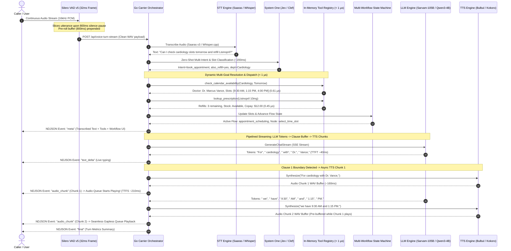
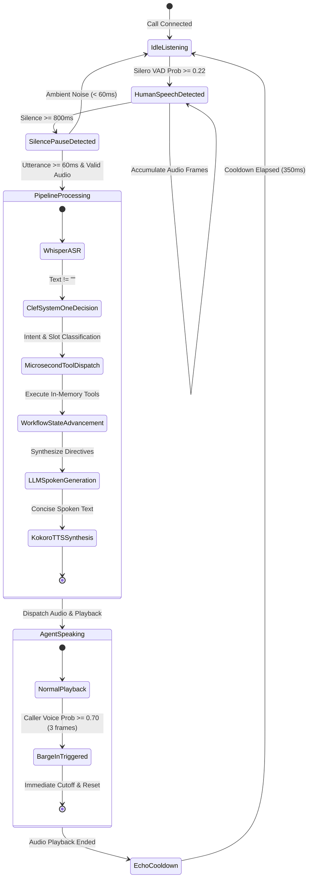

# Beacon Health | Real-Time Agentic Voice Orchestration Logic

This document specifies the end-to-end **Orchestration Logic**, **Turn Lifecycle State Machine**, **Multi-Workflow Engine**, and **Concurrency Models** powering the Beacon Health Local Real-Time Agentic Voice Carrier.

---

## 1. End-to-End Turn Orchestration Flow



---

## 2. Real-Time Turn Lifecycle State Machine

The orchestration pipeline transitions through six strictly ordered deterministic states per conversational turn:



---

## 3. Algorithmic Orchestration Breakdown

### Step 1: VAD Slicing & Pre-Roll Buffering
- **Frame Size**: $512$ samples ($32\,\text{ms}$ at $16\,\text{kHz}$).
- **Pre-Roll Circular Buffer**: Stores the preceding $800\,\text{ms}$ ($12,800$ samples) in memory.
- **Speech Onset Trigger**: Activated when Silero VAD human voice probability $P \ge 0.22$ (or single-frame debounce $P \ge 0.18$).
- **Turn Assembly**: Onset immediately prepends the pre-roll buffer to prevent losing initial short affirmative words (*"Yeah"*, *"Yes"*, *"No"*, *"Sure"*).
- **Silence Debounce**: Finalizes the utterance after $800\,\text{ms}$ of continuous silence ($P < 0.18$).

### Step 2: System One Fast Semantic Classification
Instead of slow recursive LLM tool-calling roundtrips, incoming text is evaluated in a single forward pass by **Clef-Flash System One** (Port `8085`):
```json
{
  "state": "The caller says: \"Can I check cardiology slots tomorrow and refill Lisinopril?\"",
  "questions": {
    "intent": { "type": "choice", "criteria": { "book_appointment": "...", "refill_medication": "...", ... } },
    "also_refill": { "type": "choice", "criteria": { "yes": "Refill requested", "no": "No refill" } },
    "also_booking": { "type": "choice", "criteria": { "yes": "Booking requested", "no": "No booking" } },
    "department": { "type": "choice", "criteria": { "Cardiology": "...", "Dermatology": "...", ... } },
    "time_slot": { "type": "choice", "criteria": { "9:30 AM": "...", "1:15 PM": "...", "4:00 PM": "..." } },
    "fulfillment": { "type": "choice", "criteria": { "Delivery": "...", "Pickup": "..." } },
    "pay_bill": { "type": "choice", "criteria": { "yes": "Pay bill", "no": "Not paying" } }
  }
}
```

### Step 3: Sub-Microsecond In-Memory Tool Execution
The orchestrator dynamically dispatches mapped domain tools in Go memory:
- `check_calendar_availability`: Looks up physician schedule in $\approx 0.61\,\mu\text{s}$.
- `lookup_prescription`: Verifies active medication, copay, and remaining refills in $\approx 0.45\,\mu\text{s}$.
- `lookup_doctor_profile`: Fetches board certification and background in $\approx 0.51\,\mu\text{s}$.
- `confirm_appointment_booking`: Issues verified reservation ID in $\approx 0.82\,\mu\text{s}$.
- `process_copay_payment`: Authorizes credit card transaction in $\approx 0.75\,\mu\text{s}$.
- `clinical_symptom_triage`: Classifies urgent acuity levels in $\approx 0.40\,\mu\text{s}$.

### Step 4: Multi-Goal Compound Directive Synthesis
When multiple requests are identified in a single caller utterance, the orchestrator generates a unified multi-task directive header:
```
MULTI-GOAL UTTERANCE (2 distinct requests detected: (1) Doctor Appointment Scheduling, (2) Prescription Refill Order).
Directives: You MUST address ALL 2 requests in your single spoken response using the system execution results below.
- Appointment Availability: Available slots for Cardiology tomorrow with Dr. Marcus Vance are 9:30 AM, 1:15 PM, and 4:00 PM.
- Prescription Found: Lisinopril 10mg has 3 refills in stock ($12.00 copay). Home delivery or pickup available.
```

### Step 5: Conversational Spoken LLM Generation
- **Model**: Qwen3-4B running on `llama-server` (Port `8080`).
- **Spoken Negative Constraints**:
  - `CRITICAL SPOKEN RULE: NEVER begin your response with 'Hello', 'Hi', 'Hi there', 'Hey', 'Welcome to Beacon Health', or 'I'm Aria' unless this is the very first turn of the conversation.`
  - `Always prioritize answering the caller's LATEST utterance without repeating previously completed tasks.`
  - `Concise natural spoken response: 1-2 sentences maximum, zero markdown bullet points or numbers.`

### Step 6: Acoustic Echo Suppression & Cooldown
- **Muted DSP Loop**: The Web Audio ScriptProcessor output is routed through a zero-gain `muteNode` (`gain.value = 0.0`) to destination, preventing physical speaker feedback.
- **Playback Muting**: All microphone frame accumulation is suppressed while `isAgentSpeaking === true`.
- **$350\,\text{ms}$ Reverberation Cooldown**: When audio playback finishes, a $350\,\text{ms}$ lock (`agentSpeakingCooldownUntil`) absorbs lingering room acoustic decay.

---

## 4. Multi-Workflow State Machine Matrix

The orchestrator maintains 7 business workflows with slot persistence across conversational turns:

| Workflow ID | Workflow Name | Initial Node | Key Extracted Slots | Terminal Node |
| :--- | :--- | :--- | :--- | :--- |
| `reception_dispatcher` | Clinic Front Desk Reception | `welcome_reception` | `inquiry_type`, `department` | `routed_to_service` |
| `appointment_scheduling` | Doctor Appointment Scheduling | `select_department` | `department`, `date`, `time_slot`, `patient_name`, `booking_id` | `appointment_confirmed` |
| `prescription_refill` | Prescription Refill & Pharmacy | `lookup_rx` | `medication`, `rx_number`, `fulfillment_method`, `refill_order_id` | `refill_confirmed` |
| `lab_results` | Diagnostic Lab & Blood Panel | `patient_verification` | `patient_id`, `test_status`, `reviewed_by` | `review_results` |
| `billing_inquiry` | Billing Statement & Copay | `invoice_lookup` | `invoice_id`, `copay_due`, `auth_code`, `balance` | `billing_completed` |
| `reschedule_cancel` | Manage Existing Appointment | `lookup_booking` | `booking_id`, `cancellation_reason`, `refund_status` | `management_complete` |
| `clinical_triage` | Acute Symptom Triage | `symptom_intake` | `symptoms`, `acuity`, `triage_level`, `recommendation` | `urgent_routing` |

---

## 5. Concurrency & Thread Safety Model

```go
type VoicePipelineEngine struct {
    WhisperURL string
    ClefURL    string
    TTSURL     string
    LLMURL     string
    Tools      *ToolRegistry
    Workflow   *MultiWorkflowEngine
    LLM        *LLMClient
    client     *http.Client
    mu         sync.Mutex          // Guards conversational history and multi-turn state
    history    []map[string]string // Rolling conversation memory (bounded to last 6 turns)
}
```

1. **State Isolation**: Every incoming turn acquires a thread-safe mutex lock `p.mu.Lock()` when querying or updating rolling dialogue history.
2. **Context Bounding**: Conversation history is capped at the last 6 turns (`history[len-6:]`) to maintain high GPU throughput and avoid context-bloat latency degradation.
3. **Stateless Tool Dispatch**: All tools in `agent.DefaultTools` execute pure in-memory state lookups without disk I/O bottlenecks.
